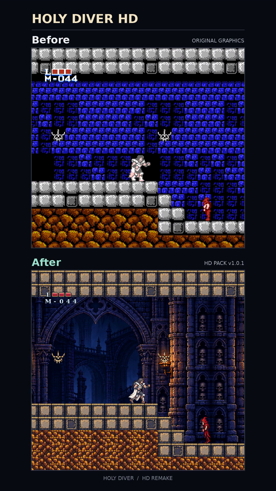
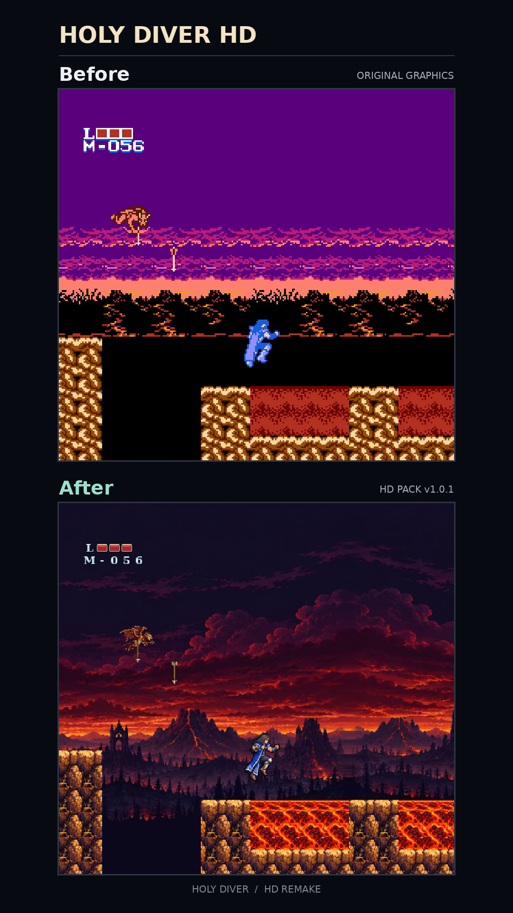
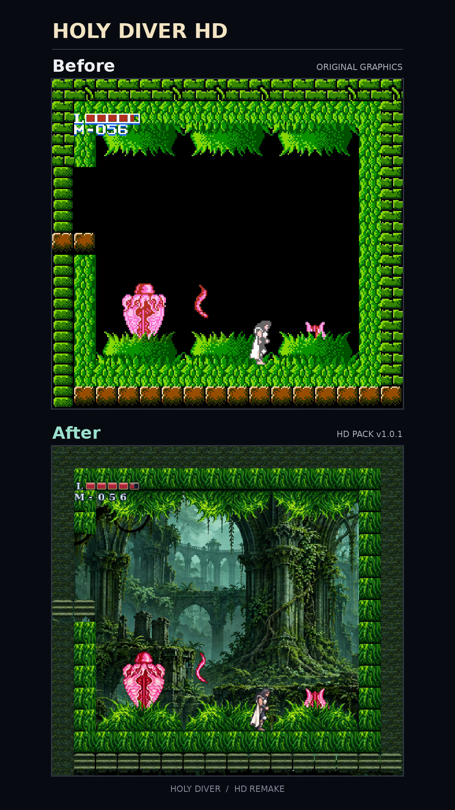
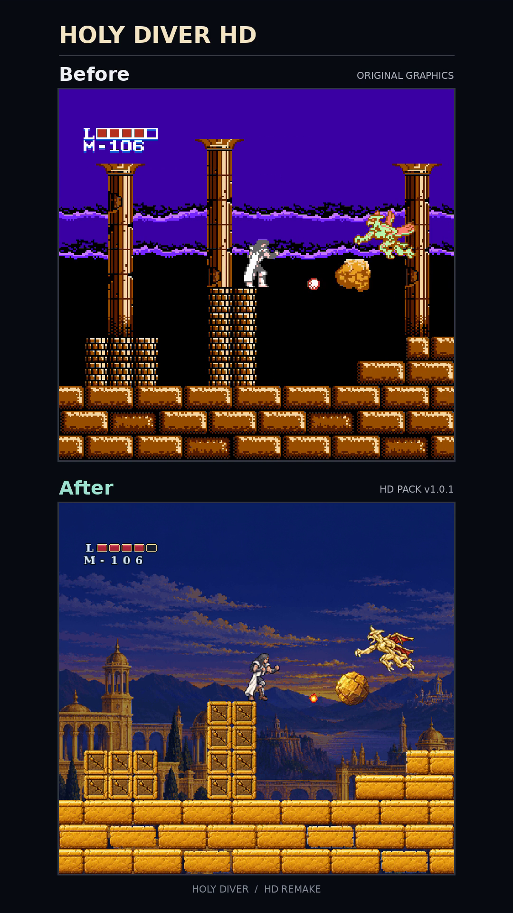

# Holy Diver HD

**Version 1.0.1** — an HD graphics pack for Holy Diver on the NES, with updated characters, enemies, scenery, items and effects throughout all six stages.

## Download

Get **Holy_Diver_HD_v1.0.1.zip** from [Releases](https://github.com/kgrant191/holy-diver-hd/releases). This is the installable HD pack. GitHub's automatic source-code archives are for the project source.

## Before and after

Original NES graphics and the Holy Diver HD v1.0.1 pack, captured at matching gameplay moments. Click any image to view the full-size comparison.

| Gothic Chapel | Sunset Lava |
| --- | --- |
|  |  |
| **Poison Moss** | **Golden Temple** |
|  |  |

## Requirements

- **Mesen with NES HD pack support. Tested with MesenCE 2.2.1.** [Download MesenCE](https://github.com/nesdev-org/MesenCE/releases/tag/2.2.1).
- **The supported Holy Diver translated ROM** (`.nes`), with SHA-1:
  `FE2FCD0AD334D792DB16535D09F3AB9FB2BEA3AC`

The ROM and emulator are supplied separately.

## Install

Use **standalone MesenCE 2.2.1**, the tested emulator for these packs. [Download MesenCE](https://github.com/nesdev-org/MesenCE/releases/tag/2.2.1). These packs use modern Mesen 2 / MesenCE HD-pack features; original Mesen 0.9.x and RetroArch’s **legacy Mesen core** are not compatible. That core supports pack format 106, while these projects use newer features. A separate MesenCE-based RetroArch core now exists, but these releases have not been validated with it. Standalone MesenCE is the supported setup described here.

1. Download **Holy_Diver_HD_v1.0.1.zip** from the game’s Releases page. Leave the ZIP compressed.
2. Open your own supported **ROM in MesenCE**.
3. Choose **Tools > HD Packs (NES) > Install HD Pack** and select the downloaded ZIP.
4. When MesenCE reports that installation succeeded, click **OK** to reset the game and load the HD pack.

No manual extraction or folder renaming is needed for this normal installation. To update a pack, open the same ROM and install the newer release ZIP through the same menu.

[Full installation guide and troubleshooting](docs/INSTALLATION.md).

No ROM or emulator is included. Supply your own supported ROM.

## Project information

- [Release history](CHANGELOG.md)
- [Development documentation and archived notes](docs/development/README.md)
- [Contents and provenance](NOTICE.md)

