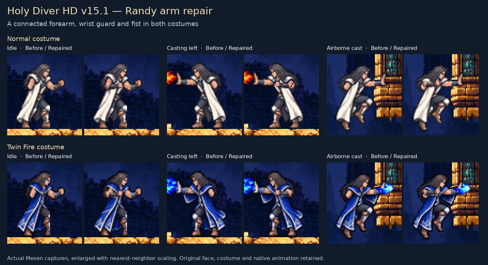

# Holy Diver HD

**Demonic Palace flash repair — 0.22.1 review.** Keeps the finished palace scenery and stonework visible during Thunder and dragon pickup, with the native flash color showing through the same artwork. Preserves ordinary frames and prior assets. [Repair and consecutive-frame checks](docs/LEVEL5_FLASH.md).

**Demonic Palace next rooms — 0.22.0 review.** Completes background coverage through the dragon stair hall and updates the next two lava rooms with the finished scenery, stone, lava/ice, Randy, HUD and returning enemies. Adds a rising horned armored sentry. Preserves the accepted 0.21.1 artwork. [Changes and tests](docs/LEVEL5_NEXT.md). Main remains approved 0.20.5.

**Demonic Palace repair — 0.21.1 review.** Gives the cavern ceiling subdued green slime, keeps the interior background visible through the stair climb, restores the HD serpent in its alternate palette, and fills stair-art gaps exposed by the restored scenery. Covers the next hall's entrance. [Changes and tests](docs/LEVEL5_REPAIR.md). Main remains approved 0.20.5.


**Demonic Palace opening — 0.21.0 review.** Adds the recorded lava cavern and crimson-column halls, skeletons, jade boulders, segmented serpent and Thunder effects. Restores the missing H in THUNDER. Approved art and gameplay remain intact. [Scope and verification](docs/LEVEL5_DEMONIC_PALACE.md). Main remains approved 0.20.5.


**Approved 0.20.5 on `main` (merged 2026-10-27).** All eight PRs [#18](https://github.com/kgrant191/holy-diver-hd/pull/18)–[#25](https://github.com/kgrant191/holy-diver-hd/pull/25) are merged. All PR/main builds and sixteen downloaded install artifacts pass; all 119 approved pack files remain exact. See [adoption and verification](docs/LEVEL4_ADOPTION.md). Earlier review labels retain their historical context.

**Background continuity — 0.20.5 review.** Completes the Poison Moss lava-corridor background checks so scenery remains visible as the camera scrolls. All approved 0.20.4 artwork remains exact. [Changes and verification](docs/BACKGROUND_CONTINUITY.md).

**Wall-boss entrance repair — 0.20.4 review.** Reuses the finished normal/gold boss artwork for three missing entrance palette phases. All approved 0.20.3 assets remain exact. [Changes and verification](docs/BOSS_ENTRY_REPAIR.md).

**Tree/potion cleanup — 0.20.3 review.** Joins the chapel tree branches into the trunk using the original tree artwork, and brightens the handled red health potion. Preserves approved0.20.2. [Changes and verification](docs/TREE_POTION_CLEANUP.md).

**Golden Temple stairs and victory transition — 0.20.2 review.** Completes the opposite-facing stair undersides across all temple room copies. Adds the Thunder tome and announcement, keeps the tower HD through its defeat fade, and keeps the finished dragon silhouette through the following flight's white flash. [Changes and verification](docs/LEVEL4_TRANSITION.md).

**Golden Temple entrance/stair repair — 0.20.1 review.** Restores the visible boss-room doorway and smooths the descending stair undersides without changing their standing surface. Earlier artwork, boss animation and native gameplay/audio remain intact. [Repair and verification](docs/LEVEL4_FINISH.md).

**Golden Temple final halls and boss — 0.20.0 review.** Extends the finished temple scenery and returning enemies into both recorded halls. Adds gold/crimson hovering rings and a rotating bronze-and-teal eye tower, with native hit flashes and stone moving platforms. The recording ends at game over; boss defeat is untested. [Coverage and tests](docs/LEVEL4_FINALE.md).

**Golden Temple stray-pixel repair — 0.19.1 review.** Removes the missed original ornament tile floating in the outdoor dragon area. All artwork remains unchanged. [Repair and tests](docs/LEVEL4_RESIDUE.md).

**Golden Temple dragon and visibility — 0.19.0 review.** Updates the dragon pickup, flying/firing animations and fire breath. Improves the staff and small recovery drops, and removes decorative foreground columns so the scenery shows through. [Coverage and tests](docs/LEVEL4_DRAGON.md).

**Golden Temple staff hall and arena — 0.18.0 review.** Keeps the interior background visible through the recorded climb, completes the upper ornaments, and gives the staff pickup and Start-menu icon matching gold artwork. The following arena uses the outdoor scenery, HD player/HUD and a crimson armored sentinel. [Coverage and tests](docs/LEVEL4_STAFF.md).

**Golden Temple continuation — 0.17.0 review.** Extends the approved art through the next hall, outdoor fire-chain courtyard and recorded temple re-entry. Adds silver-white wings and fiery chain beads; reuses the existing temple scenery, stonework and restored stairs. [Coverage and tests](docs/LEVEL4_COURTYARD.md).

**Golden Temple stairs — 0.16.3 review.** Restores the stair flight incorrectly cleared as decoration, using existing gold stone and its native outline. Preserves the entry-crash fix and HD item drops. [Repair and tests](docs/LEVEL4_STAIRS.md).

**Golden Temple repair — 0.16.2 review.** Bounds-checks indoor pillar lookups to avoid a one-past-screen read on temple entry. Small health/magic drops reuse the finished heart/crystal art. All 0.16.1 artwork remains exact. [Diagnosis and verification](docs/LEVEL4_REPAIRS.md).

**Golden Temple refinement — 0.16.1 review.** Worn beveled stone replaces the square slabs; breakable blocks have distinct cracked inset faces; indoor supports have carved capitals and continuous fluted shafts. Preserves the backgrounds and outdoor pillars the user liked. [Revision and verification](docs/LEVEL4_MASONRY.md).

**Golden Temple review candidate — 0.16.0 on `feature/golden-temple`.** An outdoor golden-temple approach leads into enclosed gilded halls. Corrects OVERDRIVE in the Start menu and updates its orbiting energy orbs. Includes the recorded temple enemies and gold collision masonry. Native gameplay/audio and all earlier art remain intact. Awaiting review; approved main remains 0.15.0. See [scope and verification](docs/LEVEL4_GOLDEN_TEMPLE.md).

**Approved 0.15.0 on `main` (merged 2026-10-26).** Completes the newly recorded final climb and boss arena with the approved green moss scenery, a pink horned boss, living thorny growths and curved shots. Adds the Overdrive orb/announcement and verifies the Golden Temple title card. Native gameplay and audio remain unchanged. See [finale notes](docs/LEVEL3_FINALE.md).

Mesen HD-pack artwork and reproducible source for the translated NES Holy Diver ROM. **Previous approved baseline: 0.15.0 on `main`.** All five Level 3 PRs [#13](https://github.com/kgrant191/holy-diver-hd/pull/13)–[#17](https://github.com/kgrant191/holy-diver-hd/pull/17) are merged. All PR/main builds and ten independently downloaded install artifacts pass. See `evidence/stage3_adoption/`. The approved 0.20.5 baseline above supersedes this Level 3 handoff. Built on the historical v15.1 artwork baseline, with the approved title and ledge corrections.

**Approved 0.14.0 on `feature/poison-moss-land`.** Gives the eight completed/recorded Level 3 areas their own green moss forest, ivy-covered Gothic ruins and emerald masonry. Preserves platform contours, existing wood, actors, fish stabilization, lava/ice and native gameplay/audio. See [Poison Moss Land](docs/POISON_MOSS.md).

The approved work is merged through PRs [#8](https://github.com/kgrant191/holy-diver-hd/pull/8) → [#9](https://github.com/kgrant191/holy-diver-hd/pull/9) → [#10](https://github.com/kgrant191/holy-diver-hd/pull/10) → [#11](https://github.com/kgrant191/holy-diver-hd/pull/11). All four PR and main merge builds pass. Their downloaded installation artifacts pass independent hash/layout checks. See STATUS.md for adoption details.

**Approved Breaker Randy repair (0.10.2).** Keeps the existing HD Randy poses through all three final pickup-fade palettes in both normal and Twin Fire costumes. All artwork files remain byte-identical to approved 0.10.1. Approved by the user and merged through [PR #12](https://github.com/kgrant191/holy-diver-hd/pull/12). See [repair verification](docs/BREAKER_RANDY.md).

**Boss defeat/pickup repair (0.10.1).** Keeps the HD boss through both gold defeat-fade palettes and removes its outline during the Breaker pickup flash. All other artwork and native gameplay/audio remain intact. See [repair verification](docs/BOSS2_REVIEW.md).

**Level 2 boss and Breaker (0.10.0).** Adds the complete wall-root demon, native hit/defeat palette phases, a new Breaker tome and its announcement. Reuses the existing cave, brown rock texture, actor poses, HUD and fireball. The supplied state supports a controller-only victory and collection route through the existing Stage 3 title card. See [boss notes](docs/BOSS2.md).

**Screen 2-6 and shared artwork (0.9.0).** Known Stage 2 enemies, terrain, stairs, lava/ice and items now have shared fallback mappings, so matching native identities and palettes reuse their finished artwork in later rooms. Specific room mappings keep priority. Screen 2-6 reuses the crimson cave, original brown terrain and bats; the only new painted subject is its two-pose walking dragon. Its fireball reuses the existing source. See [screen notes and coverage](docs/SCREEN2_6.md).

**Original brown ceiling (0.8.3).** Restores the exact brown ceiling artwork from 0.8.0, with the approved cut-stone stairs intact. Reuses existing atlas cells; no new artwork. See [restoration notes](docs/SCREEN2_5_BROWN_ROOF.md).

**Rejected ceiling (0.8.2).** Restores a solid charcoal/plum foreground ceiling so head-bump boundaries and hanging bats are clear against the red cave. The user-accepted cut-stone stairs and every previous runtime asset remain byte-identical. See [ceiling review](docs/SCREEN2_5_ROOF.md).

**Earlier cave review (0.8.1).** Distinct cut-stone steps replace rock-textured stairs. Foreground red columns are removed to reveal the crimson panorama. The user accepted the stairs but found the thin overhead outline unclear; 0.8.2 restores solid ceiling stone. A previously unmapped handled health jug now has an opaque red/brass body. Earlier flasks and all prior source artwork remain exact. See [review notes](docs/SCREEN2_5_REVIEW.md).

**Screen 2-5 crimson cave (0.8.0).** Large ruby-red formations and dark burgundy recesses give the cave depth, with crimson mineral columns in front. Reuses approved gold terrain, bats and floating eyes with blue tears, and includes the screen 2-4 stair repair. See [screen notes](docs/SCREEN2_5.md).

**Screen 2-4 stair repair (0.7.1).** The end-of-room stairs now use the accepted gold texture inside their native contours. Paired tests cover both flights and entry into 2-5. See [stair repair](docs/SCREEN2_4_STAIRS.md).

**Screen 2-4 original candidate (0.7.0).** Reuses the accepted cave panorama, gold terrain, winged demons with downward arrows, pulsing rocks and shared player/HUD assets. The additional ceiling shapes use the existing gold texture. See [screen notes](docs/SCREEN2_4.md).

**Approved 0.6.1 (`feature/screen2-3`), accepted on 2026-10-24.** The floating eyes now shed blue teardrops, with pointed tops and rounded liquid bodies. Only their two projectile cells change; the eye bodies, scenery, other fireballs and native behavior remain unchanged. See [repair notes](docs/SCREEN2_3_REVIEW.md) and [actual blue-tear comparison](evidence/screen2_3_review/comparison.png).

**Original screen addition 0.6.0 (`feature/screen2-3`).** Adds the vertical cave and floating eye, reusing the approved cave panorama, gold platforms, ghouls, lava/ice, player and HUD. Tests traverse the complete vertical room and enter the next room. See [screen notes](docs/SCREEN2_3.md) and [actual Mesen comparison](evidence/screen2_3/comparison.png). The source handoff includes both approved screen2-2 and screen2-3 branches. Both artwork branches and the approval record are now published. [PR #6](https://github.com/kgrant191/holy-diver-hd/pull/6) and [PR #7](https://github.com/kgrant191/holy-diver-hd/pull/7) passed Actions; both downloaded packs match the approved hashes with no nested ZIP. Both PRs were merged after the user explicitly authorized them. The main v0.6.1 Actions artifact also passes all 85 expected hashes and contains no nested ZIP.

**Approved 0.5.1 (`feature/screen2-2`), accepted on 2026-10-24.** Removes the reddish hanging decoration to reveal the cave backdrop and restores downward flow to hot lava falls. Blizzard ice stays still. Retains 0.5.0's ceiling bats and shared terrain, pools, ghouls, player and HUD. Merged through [PR #6](https://github.com/kgrant191/holy-diver-hd/pull/6). See [review fixes](docs/SCREEN2_2_REVIEW.md), [original cave implementation](docs/SCREEN2_2.md) and [live comparison](evidence/screen2_2_review/comparison.png).

Version 0.4.1 fixes the cave entrance showing clouds before its far wall appears, replaces the flyers with brown winged demons that face their travel direction and drop downward arrows, and restores the red enemies to faceless pink-shell forms with pulsing crimson lobes. See [review repairs](docs/SCREEN2_1_REVIEW.md). Approved by the user on 2026-10-23 and merged through [PR #5](https://github.com/kgrant191/holy-diver-hd/pull/5). PR and main Actions builds passed; both downloaded artifacts contain 82 root files with exact approved hashes and no nested ZIP.

Version 0.4.0 adds Stage 2 screen 1: a volcanic Gothic backdrop, native gold platforms, palette-driven lava and Blizzard ice, flying imps, three tumbling lava-creature poses, destructible gold blocks and the exit cliff. Reuses approved Randy, HUD, pickups and defeat effects. See [screen notes](docs/SCREEN2_1.md) and [actual Mesen comparison](evidence/screen2_1/comparison.png). The feature and subsequent repairs are approved together in 0.4.1 on `feature/screen-2-1`.

Version 0.3.5 adds the large red HP and blue Magic flasks with shared mappings for their identical native graphics copies. Previous artwork, including the confirmed standing-leg repair, remains exact. See [recovery items](docs/RECOVERY_ITEMS.md) and [live comparison](evidence/recovery_items/comparison.png).

Version 0.3.4 corrects the disconnected knee/shin introduced by the rejected 0.3.3 boot repair. The forward standing leg is registered as one continuous thigh, knee, shin and boot in both costumes and directions. Crouching and all other poses stay exact. See [standing leg correction](docs/RANDY_LEG.md) and [live comparison](evidence/randy_leg/comparison.png).

Version 0.3.2 keeps the Blizzard ascent backdrop filled across the vertical wrap and preserves Randy's HD silhouette through the final white/gray fade. The native repeated bell, ornaments and flash timing remain intact. See [transition repair](docs/BOSS1_TRANSITION.md) and [live comparison](evidence/boss1_transition/comparison.png).

Version 0.3.1 fixes the Blizzard pause menu's original-font R/D letters and enables Mesen's sprite-limit removal so the boss fireball stays complete on crowded scanlines. The option applies automatically while this pack is loaded. See [review fixes](docs/BOSS1_REVIEW.md) and [live comparison](evidence/boss1_review/comparison.png).

Version 0.3.0 adds the first boss and Blizzard chamber: six native boss poses, crouched/standing fire, white hit flashes, progressive defeat, brass organ pipes, the bell and spell collectible, and the ascent/announcement into Stage 2. Existing Randy/HUD artwork follows the identical graphics-bank copies used in the transition. See [boss notes](docs/BOSS1.md) and [live comparison](evidence/boss1/comparison.png). The complete feature, including the subsequent fixes and recovery pickups, was approved by the user on 2026-10-23 for adoption through [PR #4](https://github.com/kgrant191/holy-diver-hd/pull/4).

Version 0.2.1 revises screen 1-4 with a front-facing 1-up figurine in both colors and a continuous Gothic wall with complete arches. The tree court retains the approved entrance tree, native branches and floor, and shared HD ghoul poses. See [revision notes](docs/SCREEN1_4_REVIEW.md) and [live comparison](evidence/screen1_4_review/comparison.png). Approved by the user on 2026-10-23; adoption and Actions artifact verification are tracked in [PR #3](https://github.com/kgrant191/holy-diver-hd/pull/3).

Version 0.1.1 sharpens the standing ghoul and covers both crouching attack phases for normal/Twin Fire Randy. Its 0.1.0 base adds the third chapel section, with a solid masonry backdrop, stained-glass windows, reinforced blocks, a gold serpent ornament, a six-pose rolling ghoul and two-pose blue flying skulls. Includes the entrance and screen-2 overhaul, shared Randy/weapon art, bracelet pickup and pause icon, defeat effects, and stage/lives cards. The rest of the game remains work in progress.



## Approved Level 3 detail corrections — 0.11.2

Updates the round enemy shot identified in the screenshot, the magenta boot collectible, and solid two-row oak branches. Existing branch contours and all 96 previous runtime assets remain exact. See [detail notes and verification](docs/LEVEL3_DETAILS.md).

## Previous Level 3 review — 0.11.1

Adds the spinning blade-ring enemy, two small flame sprites, an insect interpretation of the small winged eye, and continuous shaded bark. See [review notes and verification](docs/LEVEL3_REVIEW.md).

## Original Level 3 opening review — 0.11.0

The review branch adds the forest approach, tree climb, and stone shaft from a standard Mesen movie. It reuses the approved player, HUD and returning enemies, and adds the new forest scenery and small creatures. Later Level 3 scenery and its boss remain unfinished. See [scope and live checks](docs/LEVEL3_OPENING.md). Approved main stays at 0.10.2 until review.

## Build

Use Python 3.12:

```sh
python -m venv .venv
. .venv/bin/activate
python -m pip install -r requirements.txt
python build.py
python scripts/verify_release.py
```

On Windows, activate the virtual environment with its Scripts/Activate.ps1 file. No ROM or emulator is required to build or validate.

Output on this branch: `build/Holy_Diver_HD_v0.20.5.zip`, with the contents of `build/Holy_Diver_(Tr)/` at the ZIP root. The version comes from VERSION. GitHub Actions uploads that directory's files directly, so its downloaded artifact ZIP also exposes hires.txt and the assets after one extraction. It does not contain a second ZIP. Development artifacts are for testing; official GitHub Releases require the user's explicit release approval.

## Versioning

Development starts at **0.0.1**. Increment the patch for compatible fixes or small visual polish (0.0.2), and the minor for new screens or substantial features (0.1.0). Reserve **1.0.0** for the completed, tested game pack. After 1.0.0, major versions indicate breaking compatibility changes. Historical v12–v15.1 labels remain in provenance and evidence; they are not semantic releases.

## Install

Extract the ZIP directly into the Mesen HD-pack folder matching the ROM filename, for example `Mesen/HdPacks/Holy_Diver_(Tr)/`. hires.txt must be directly inside that folder. Enable NES HD packs and fully close/reopen the ROM.

Supported translated ROM SHA-1: `fe2fcd0ad334d792db16535d09f3ab9fb2bea3ac`. Tested with MesenCE 2.2.1. Supply the ROM and emulator separately; neither is included. See INSTALL.txt for the original pack instructions.

## Project files

| Path | Purpose |
| --- | --- |
| AGENTS.md | Instructions for future coding-agent sessions |
| STATUS.md | Approved work, known limits and next task |
| CHANGELOG.md | Development version and release history |
| VERSION | Current semantic version used by the build |
| art/ | Source images, registered sprites, metadata and font license |
| scripts/ | Builders, validators, Lua replay templates and capture tools |
| rollback/ | Exact older pack inputs used by the current build |
| evidence/ | Compact live reports/captures and approved pack hashes |
| docs/ | Art direction, testing setup, repository workflow and prior notes |
| test_states/ | Tracked setup guide; ignored local emulator inputs |

## Continuing work

Start against this repository and read AGENTS.md and STATUS.md. Use a focused branch, test affected visuals in Mesen, and keep main at the approved version. Update status and changelog when work is accepted.

CI checks mappings, tile bounds, conditional ordering, approved asset hashes and the audio patch. It does not replace live emulator testing. Read docs/TESTING.md.

Historical rollback inputs are retained for reproducibility. Future Git commits provide additional version history. See docs/REPOSITORY_WORKFLOW.md and NOTICE.md.
